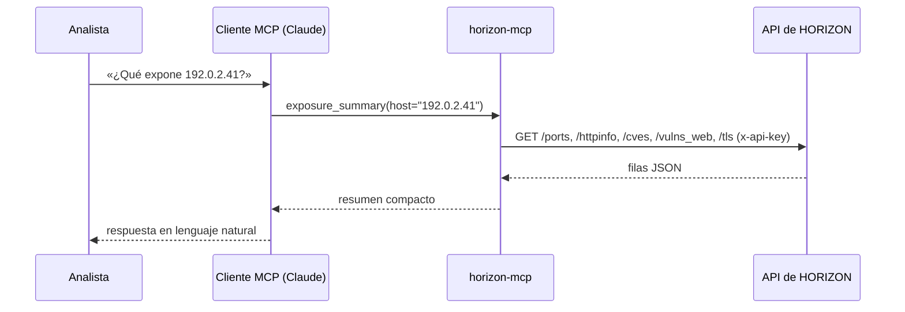

# Qué es MCP

El **Model Context Protocol** (MCP) es un protocolo abierto que permite a un asistente de IA
descubrir y llamar a **herramientas** de un programa externo. El programa (el *servidor
MCP*) declara las herramientas que ofrece, con nombre, parámetros y descripción; la
aplicación del asistente (el *cliente MCP*) las presenta al modelo, y el modelo decide cuándo
llamarlas a partir de la pregunta del usuario.

## Por qué un servidor MCP y no un script

- **El analista pregunta, no programa.** Las preguntas se hacen en lenguaje natural; el
  modelo elige la herramienta, los parámetros y encadena llamadas si hace falta.
- **Las descripciones de las herramientas son parte del producto.** Lo que el modelo lee para
  decidir (los *docstrings* de cada herramienta y las instrucciones del servidor) está
  escrito con el vocabulario del analista y con los avisos necesarios (CVE inferidas,
  frescura).
- **Un solo servidor para muchos clientes.** Claude Desktop, Claude Code o cualquier cliente
  MCP usan el mismo código sin adaptar nada.
- **Separación clara.** El servidor tiene la clave y habla con HORIZON; el cliente tiene el
  modelo y habla con la persona. Ninguno de los dos ve lo que no le toca.

## Cómo se conectan

En **`stdio`**, el cliente arranca el servidor como proceso hijo y le habla por la entrada y
la salida estándar. Es el modo de Claude Desktop y Claude Code en local: no hay ningún
puerto abierto.

En **`streamable-http`**, el servidor escucha en un puerto y los clientes llegan por HTTP.
Es el modo de servicio compartido, y por eso pide autenticación
(véase [Seguridad](seguretat.md)).

## Lo que el modelo sabe del servidor

Al conectarse, el cliente recibe las **instrucciones del servidor**: un texto que explica qué
es HORIZON, cómo interpretar los resultados (frescura, CVE inferidas, *virtual host* por
defecto) y qué herramienta usar para cada tipo de pregunta. Eso es lo que hace que las
respuestas lleven los matices adecuados sin que el analista tenga que pedirlos.
