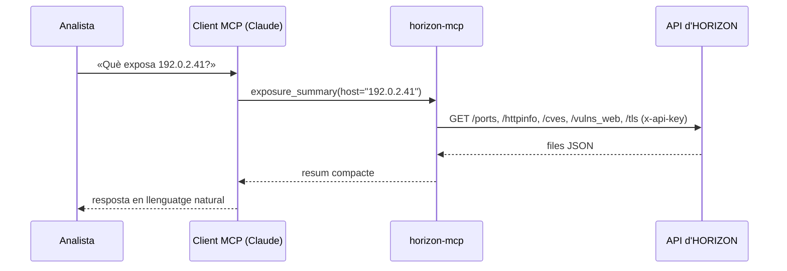

# Què és MCP

El **Model Context Protocol** (MCP) és un protocol obert que permet a un assistent d'IA
descobrir i cridar **eines** d'un programa extern. El programa (el *servidor MCP*) declara
les eines que ofereix, amb nom, paràmetres i descripció; l'aplicació de l'assistent (el
*client MCP*) les presenta al model, i el model decideix quan cridar-les a partir de la
pregunta de l'usuari.

## Per què un servidor MCP i no un script

- **L'analista pregunta, no programa.** Les preguntes es fan en llenguatge natural; el model
  tria l'eina, els paràmetres i encadena crides si cal.
- **Les descripcions de les eines són part del producte.** El que el model llegeix per
  decidir (els *docstrings* de cada eina i les instruccions del servidor) està escrit amb
  el vocabulari de l'analista i amb els avisos que calen (CVE inferides, frescor).
- **Un sol servidor per a molts clients.** Claude Desktop, Claude Code o qualsevol client
  MCP fan servir el mateix codi sense adaptar res.
- **Separació clara.** El servidor té la clau i parla amb HORIZON; el client té el model i
  parla amb la persona. Cap dels dos veu el que no li toca.

## Com es connecten

En **`stdio`**, el client arrenca el servidor com a procés fill i hi parla per l'entrada i
la sortida estàndard. És el mode de Claude Desktop i Claude Code en local: no hi ha cap
port obert.

En **`streamable-http`**, el servidor escolta en un port i els clients hi arriben per HTTP.
És el mode de servei compartit, i per això demana autenticació
(vegeu [Seguretat](seguretat.md)).

## El que el model sap del servidor

En connectar-se, el client rep les **instruccions del servidor**: un text que explica què és
HORIZON, com interpretar els resultats (frescor, CVE inferides, *virtual host* per defecte)
i quina eina usar per a cada tipus de pregunta. Això és el que fa que les respostes portin
els matisos adequats sense que l'analista els hagi de demanar.
